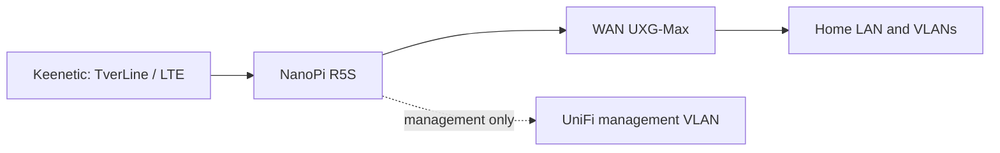

# NanoPi R5S VLESS Gateway — system design

- **Status:** approved design
- **Date:** 2026-10-20
- **Initial build:** `1.0.0-beta001`
- **Repository:** `NikaSir/vless-gateway`
- **Home Assistant consumer:** `NikaSir/ha-vless-gateway`

## 1. Purpose

Build a reproducible, recoverable production gateway that sits between the existing Keenetic uplink router and the WAN interface of UniFi UXG-Max.

The gateway must:

- send Russian resources directly through the active Keenetic provider;
- send all other IPv4 internet traffic through VLESS;
- use Germany as the primary VLESS route and the Netherlands as the reserve;
- fail open to direct internet when both VLESS routes are unavailable;
- preserve Keenetic's TverLine/LTE failover;
- add no kernel NAT or masquerading on NanoPi;
- expose authenticated read-only telemetry to Home Assistant;
- never store production secrets in Git.

Success means the gateway can be inserted and removed predictably, keeps internet access during software/VLESS failures, and has verified rollback and manual cable-bypass procedures.

## 2. Fixed decisions

| Area | Decision |
|---|---|
| Hardware | NanoPi R5S LTS, 4 GB RAM, 64 GB eMMC |
| Supported hardware in v1 | NanoPi R5S only |
| OS baseline | FriendlyWrt 24.10.2 |
| Proxy baseline | sing-box 1.12.22 with Clash API support |
| Init and firewall | FriendlyWrt/OpenWrt `procd`, UCI and firewall4/nftables |
| Position | Keenetic → NanoPi R5S → WAN UXG-Max |
| Downstream ownership | UXG-Max retains LAN/VLAN, DHCP, Wi-Fi policy and its existing NAT |
| NanoPi NAT | No SNAT/masquerade |
| Traffic policy | Russia → DIRECT; all other public IPv4 destinations → VLESS |
| VLESS priority | Germany → Netherlands → DIRECT |
| Failure policy | Fail-open |
| DNS | Split DNS, aligned with routing policy |
| IP scope | IPv4 only in v1; IPv6 is explicitly disabled on the transit path |
| HA scope in v1 | Authenticated read-only API and telemetry |
| Release format | `MAJOR.MINOR.PATCH-betaNNN`; first build `1.0.0-beta001` |

Raspberry Pi, Debian/Armbian, systemd and container deployment are outside the first-version support boundary.

## 3. Network architecture



### 3.1 Physical roles

The two 2.5 GbE ports form the data path:

- **upstream:** connected to a Keenetic LAN segment;
- **downstream/transit:** connected to the selected UXG-Max WAN port.

The 1 GbE port is **management only** and connects to the UniFi management VLAN. It has no default route and cannot forward user traffic.

Linux interface names are not hard-coded. Provisioning records MAC address, physical label and logical role in the local hardware inventory. Installation stops if the role mapping is incomplete or ambiguous.

### 3.2 Addressing and routing

The downstream link uses a dedicated configurable transit subnet. The initial default is `192.168.2.0/24`, but the installer must reject it if it overlaps any existing Keenetic, UniFi, VPN or management network.

The intended local layout is:

- NanoPi downstream address: first usable address in the transit subnet;
- UXG-Max WAN address: fixed second usable address;
- UXG-Max WAN gateway and DNS: NanoPi downstream address;
- NanoPi upstream address: Keenetic DHCP reservation;
- Keenetic: static return route for the transit subnet through the NanoPi upstream address.

NanoPi must not contain an nftables `masquerade` or SNAT rule for transit traffic. UXG-Max remains the only downstream NAT boundary.

### 3.3 Management isolation

The management interface:

- has a static or reserved address in the UniFi management VLAN;
- has no default route;
- accepts the gateway API only from the Home Assistant host and the approved administrator subnet;
- accepts SSH keys only;
- is excluded from TUN interception and transit forwarding.

The sing-box Clash API listens only on `127.0.0.1` and is never exposed directly.

## 4. Components

### 4.1 FriendlyWrt

FriendlyWrt owns:

- physical interface configuration;
- the upstream default route;
- IPv4 forwarding;
- firewall4/nftables policy;
- DNS listener exposure to UXG-Max;
- `procd` service lifecycle;
- fail-open kernel forwarding when TUN interception is absent.

### 4.2 sing-box

sing-box is the data plane and owns:

- TUN and nftables interception of downstream IPv4 traffic;
- VLESS + REALITY + Vision outbounds for Germany and the Netherlands;
- the direct outbound;
- protocol sniffing;
- route rule-set evaluation;
- split DNS;
- Selector state used by the controller;
- traffic and connection telemetry exposed only on the local Clash API.

The packaged or installed sing-box binary must include Clash API support. Provisioning verifies the exact version and required features before changing live routing.

### 4.3 `gatewayd`

`gatewayd` is a static Linux ARM64 service managed by `procd`. It owns:

- VLESS health checks;
- the strict priority state machine;
- Selector changes through the loopback Clash API;
- hysteresis and route-change history;
- configuration/rule-set activation status;
- the read-only `/api/v1` service;
- redacted diagnostics;
- system and traffic telemetry normalization.

It does not contain VLESS credentials and does not modify FriendlyWrt network topology during normal operation.

### 4.4 `gatewayctl`

A local root-only CLI provides:

- status and diagnostics;
- configuration validation;
- rule-set update;
- backup and restore;
- controlled service reload;
- route preferences `auto`, `prefer-de`, `prefer-nl` and `direct`.

The preference modes remain fail-open. v1 has no operator mode that can intentionally black-hole the household internet.

### 4.5 Home Assistant boundary

`NikaSir/ha-vless-gateway` remains a separate product. It consumes the gateway API and owns Home Assistant entities and the panel. It never stores or edits sing-box configuration.

The first integration increment is read-only. Write services remain excluded until a separate authenticated command contract, confirmation UI and factual acknowledgement model are reviewed.

## 5. Traffic and DNS policy

Rules are evaluated in this order:

1. loopback, private infrastructure, management networks and the VLESS server destinations → DIRECT;
2. explicit local force-direct overrides → DIRECT;
3. explicit local force-VLESS overrides → selected VLESS route;
4. `geosite-ru` domains → DIRECT;
5. `geoip-ru` destination networks → DIRECT;
6. all remaining public IPv4 traffic → selected VLESS route.

The custom force-VLESS list intentionally precedes the Russian lists so a known exception can be corrected without waiting for an upstream rule-set change.

### 5.1 Rule sets

The supported upstream sources are the SagerNet `sing-geosite` and `sing-geoip` binary rule-set branches. The active files are local, versioned by a manifest and retained as last-known-good data.

A rule-set update is:

1. downloaded to a staging directory;
2. size-checked and parsed by the pinned sing-box binary;
3. combined with local overrides;
4. checked with the complete generated configuration;
5. atomically activated;
6. automatically rolled back if sing-box fails its post-reload health check.

A failed download or validation never removes the current rules. Scheduled updates run weekly; manual update is available through `gatewayctl`.

### 5.2 DNS

UXG-Max uses the NanoPi downstream address as its upstream DNS service.

- Russian domains use the direct resolver path learned/configured for the Keenetic side.
- Other domains use the configured encrypted resolver through the selected VLESS outbound.
- The initial encrypted resolver profile uses Google DNS over TLS, matching the validated test setup; it remains a non-secret configurable setting.
- In DIRECT fail-open state, the encrypted resolver temporarily uses the direct path so name resolution cannot keep the house offline.
- Local UniFi names remain owned by the internal UniFi resolver before queries are forwarded upstream.
- Protocol sniffing and the sing-box DNS reverse mapping cache complement domain routing; `geoip-ru` remains the fallback for traffic where no domain is visible.

The transit interface does not advertise or forward IPv6 in v1. IPv6 packets are rejected explicitly rather than silently bypassing VLESS policy.

## 6. Failover state machine

The controller polls both VLESS outbounds every 15 seconds through the local sing-box API using two configurable HTTPS probe targets.

A VLESS route becomes unhealthy after both probe targets fail for three consecutive cycles. Recovery requires eight consecutive successful cycles. These defaults produce fast failure response and a two-minute recovery hold-down to prevent flapping.

### 6.1 Automatic behavior

- Startup begins in DIRECT until a VLESS route passes two consecutive probes.
- Healthy Germany is selected.
- When Germany is unhealthy, healthy Netherlands is selected.
- When both are unhealthy, DIRECT is selected and status becomes `degraded_fail_open`.
- When Germany recovers for the full hold-down period, the controller returns to Germany.
- If Germany is still unhealthy but Netherlands recovers, the controller returns from DIRECT to Netherlands after the recovery hold-down.

A route change records UTC timestamp, previous route, new route, trigger and observed probe results.

### 6.2 Component failures

- If `gatewayd` stops, sing-box keeps the last selected route; `procd` restarts the controller.
- If sing-box stops, its interception rules must be removed and kernel forwarding remains DIRECT.
- If configuration reload fails, the previous generated configuration is restored.
- If rule-set refresh fails, the previous active rule sets remain.
- If NanoPi loses power or both data-path links fail, software fail-open is impossible. The documented recovery is the labeled physical cable bypass from Keenetic to UXG-Max WAN.

## 7. Configuration and secrets

Tracked repository files contain templates and obvious placeholders only.

Runtime layout:

```text
/etc/nikas-vless/
  config.json
  settings.json
  hardware.json
  secrets.json
  rules/
  overrides/
  state/
  backups/
```

Requirements:

- `secrets.json` is root-owned mode `0600`;
- backups containing secrets remain on the device or an explicitly chosen encrypted destination;
- UUIDs, REALITY keys, short IDs, server addresses, subscription URLs and API tokens are never logged;
- diagnostics replace sensitive values with type-preserving redaction;
- generated configs are written to a temporary file, validated, fsynced and atomically renamed;
- the previous working generation is retained for rollback.

The gateway API uses an independent random bearer token. The local Clash API uses a separate secret and listens only on loopback.

## 8. Gateway API v1

The API binds only to the management address. All endpoints require bearer authentication except the optional loopback-only liveness endpoint.

| Endpoint | Purpose |
|---|---|
| `GET /api/v1/status` | Gateway state, mode, active route, internet/DNS state, freshness |
| `GET /api/v1/routes` | DE/NL/DIRECT health, latency and last route change |
| `GET /api/v1/traffic` | Current rates, totals and active connections |
| `GET /api/v1/system` | Versions, uptime, temperature, load and storage |
| `GET /api/v1/diagnostics` | Redacted diagnostic snapshot |
| `GET /api/v1/health` | Authenticated component health |

Every response includes:

- `schema_version`;
- `gateway_version`;
- `generated_at` in UTC;
- a stable state value;
- explicit `available`/error information instead of invented zeroes.

The contract supplies the existing HA panel roles, including gateway, LAN, tunnel, server and internet status; active/default/DNS route; latency; uptime; traffic rates/totals; active connections; bypass count; and last route change.

No write endpoint exists in API v1.

## 9. Packaging and deployment

The first artifact is a versioned ARM64 installation archive, not an OS image and not an OpenWrt package:

```text
nikas-vless-gateway-1.0.0-beta001-aarch64.tar.gz
```

It contains:

- the `gatewayd` binary and `gatewayctl`;
- `procd` init scripts;
- sing-box templates;
- UCI/firewall include templates;
- installer, backup, restore and doctor scripts;
- JSON schemas and default non-secret settings;
- the initial last-known-good RU rule sets and manifest.

The installer is idempotent. Before any live change it creates a timestamped local backup and records a rollback command. It never reflashes eMMC and never overwrites an existing production secret file.

Repository layout evolves to:

```text
cmd/gatewayd/
cmd/gatewayctl/
internal/
config/
openwrt/
scripts/
docs/
tests/
.github/workflows/
```

The old target reference to `systemd/` is removed when implementation begins.

## 10. Verification

### 10.1 CI

CI must:

- run Go unit tests and race-enabled tests where supported;
- build deterministic `linux/arm64` binaries;
- validate JSON and JSON Schema fixtures;
- render example configs and run the pinned `sing-box check`;
- run shell syntax, ShellCheck and formatting checks;
- verify that templates contain placeholders, not production values;
- scan tracked files and generated artifacts for key, token, UUID and private-address fixtures marked as secrets;
- test the failover state machine with a fake clock and probe results;
- test API schemas and redaction;
- verify artifact contents and checksums.

### 10.2 Bench verification

Before inline installation:

- record a FriendlyWrt backup and current package/version inventory;
- identify all three physical ports by link test and MAC address;
- validate DIRECT, Germany and Netherlands separately;
- validate split DNS with representative Russian and non-Russian domains;
- verify the management port has no default route or forwarding path;
- simulate controller stop, sing-box stop, invalid config and stale rule-set download;
- restore from backup on the same device.

### 10.3 Inline acceptance

Deployment proceeds in these gates:

1. inline DIRECT only;
2. Keenetic TverLine/LTE failover;
3. Russia DIRECT and default Germany;
4. Germany failure to Netherlands;
5. both VLESS routes failed to DIRECT;
6. stable automatic recovery;
7. 24-hour soak;
8. read-only Home Assistant connection.

Acceptance requires:

- Russian samples use the direct provider egress;
- non-Russian samples use Germany and then Netherlands on failure;
- loss of both VLESS paths preserves new internet connections through DIRECT;
- Keenetic provider failover still creates working new sessions;
- no NanoPi masquerade/SNAT rule exists;
- controller restart does not interrupt the data plane;
- sing-box failure produces DIRECT forwarding rather than a persistent black hole;
- invalid configuration and rule sets are rejected;
- API freshness, status and traffic values remain factual;
- logs, diagnostics and artifacts contain no production secrets;
- rollback and physical cable bypass are performed successfully.

## 11. Explicit non-goals for v1

- Raspberry Pi or other hardware profiles;
- IPv6 routing;
- automatic hardware bypass on NanoPi power loss;
- traffic bonding or simultaneous use of TverLine and LTE;
- Home Assistant write commands;
- remote administration from the public internet;
- storing or distributing VLESS credentials;
- automatic FriendlyWrt or sing-box major-version upgrades;
- per-device/VLAN routing policy;
- container or systemd deployment.

## 12. References

- [sing-box route configuration](https://sing-box.sagernet.org/configuration/route/)
- [sing-box route rule actions](https://sing-box.sagernet.org/configuration/route/rule_action/)
- [sing-box URLTest](https://sing-box.sagernet.org/configuration/outbound/urltest/)
- [sing-box Clash API](https://sing-box.sagernet.org/configuration/experimental/clash-api/)
- [sing-box migration guide](https://sing-box.sagernet.org/migration/)
- [SagerNet sing-geosite](https://github.com/SagerNet/sing-geosite)
- [SagerNet sing-geoip](https://github.com/SagerNet/sing-geoip)
- [Home Assistant VLESS Gateway panel contract](https://github.com/NikaSir/ha-vless-gateway/blob/main/docs/VLESS_GATEWAY_PANEL.md)
